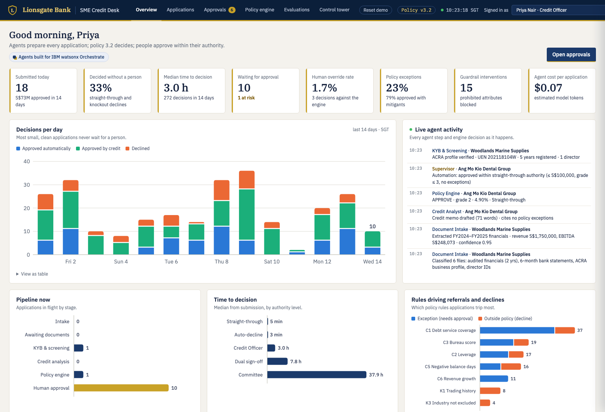
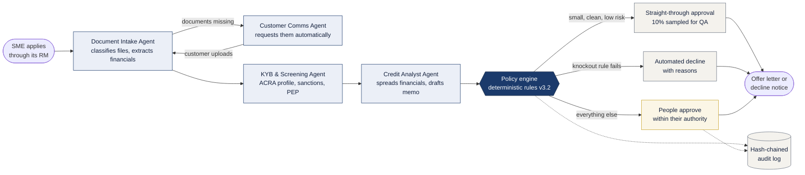
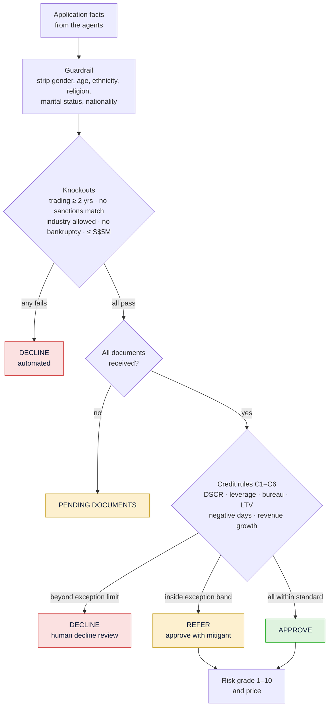
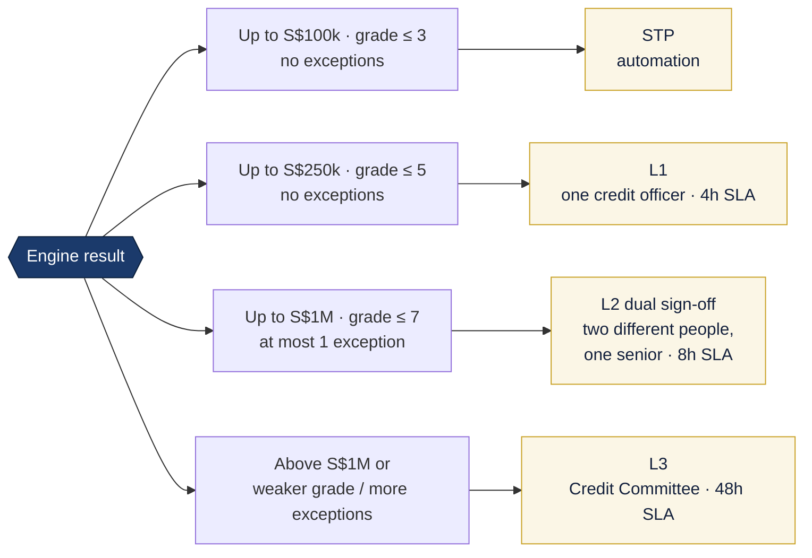
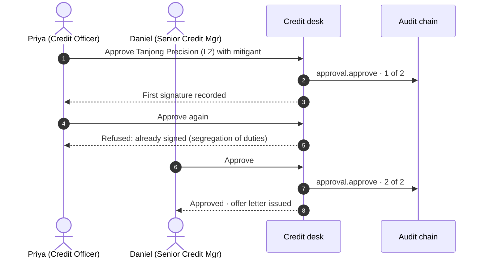
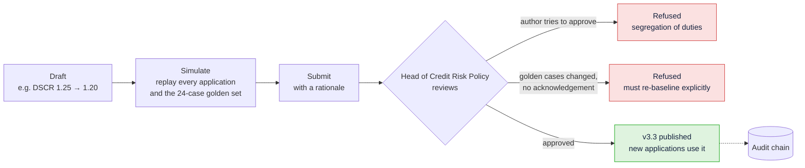
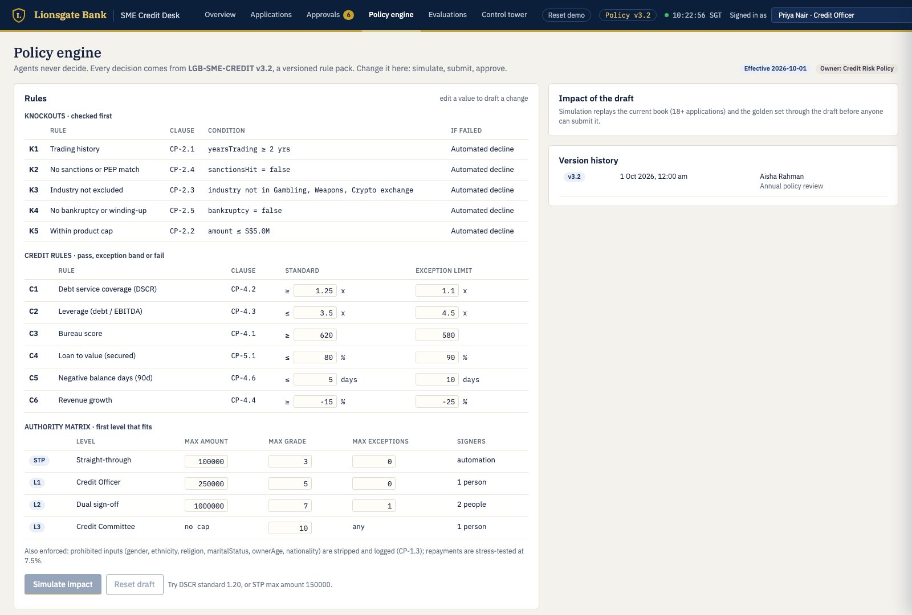
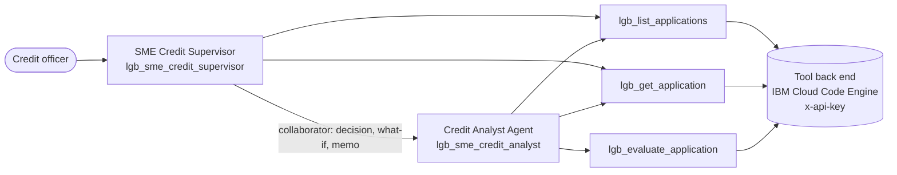
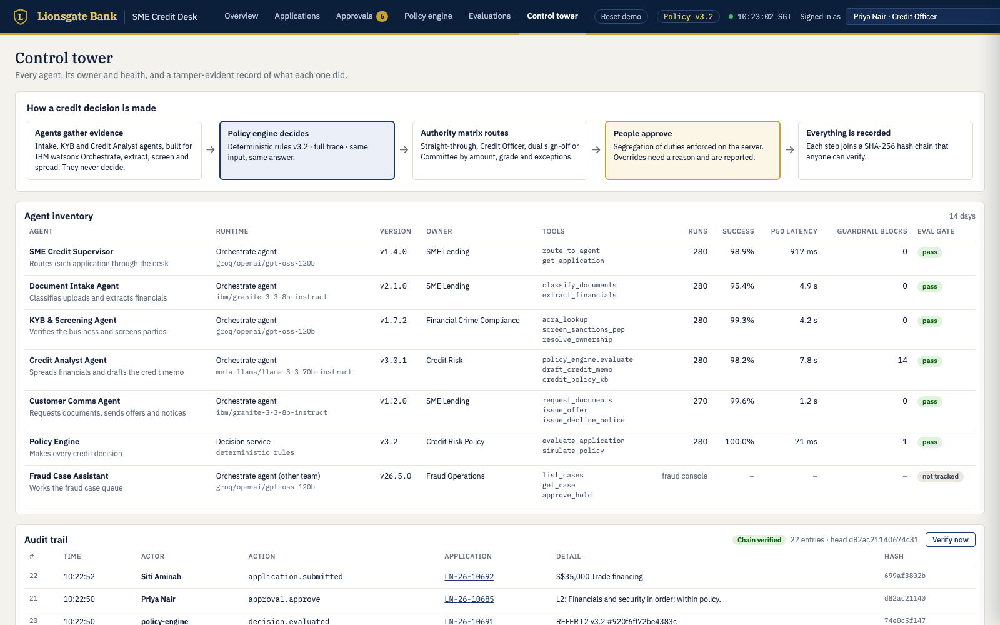

# Lionsgate Bank · SME Credit Desk

**[▶ Open the live demo](https://knijesh.github.io/lionsgate-sme-credit-desk-site/)** · runs in your browser, nothing to install · **[Guide: internals and demo script](GUIDE.md)** · **[watsonx Orchestrate agents](docs/ORCHESTRATE.md)**

An agentic SME loan-origination desk with one rule at its heart: **agents gather the evidence, a
policy engine makes the decision, people approve within their authority, and every step is
recorded.** Agents are built for **IBM watsonx Orchestrate**.



> Lionsgate Bank is fictitious; every company, person and figure is generated. In the console the
> agent steps are simulated, while the policy engine, approval controls, policy change control and
> audit chain are the real code. [What is real and what is simulated](#what-is-real-and-what-is-simulated).

---

## How an application flows



**Agents never decide.** They have no tool that can approve or decline. The decision, risk grade,
price and approval level always come from the policy engine, with a clause for every rule it applied.


## What the policy engine checks



Same input, same answer: every decision carries the policy version and a hash, and the full rule
trace is shown to the approver.

## Who has to sign



### Segregation of duties, enforced



Also enforced: no authority above your level, overriding the engine needs a written justification
(and is reported), and every action needs a reason.


## Changing the policy safely





## Built and hosted on watsonx Orchestrate

The agents live in IBM watsonx Orchestrate. They call the policy engine through an OpenAPI tool
(`orchestrate/policy-engine-openapi.yaml`) whose `x-api-key` header is supplied by an Orchestrate
connection, so no key is stored in the agent or tool definitions. The tool back end is this Node
server running on IBM Cloud Code Engine. The tool has no approve or decline operation, so the
agents cannot decide: they explain the engine's result and people sign in the console.

Built so far: the **SME Credit Supervisor** and the **Credit Analyst Agent** (its collaborator).
The Intake, KYB and Comms agents are designed but not yet built, and the agent steps in the
hosted demo are simulated. Details, tools and limits: [docs/ORCHESTRATE.md](docs/ORCHESTRATE.md).



## Agents ship through a release gate

Each agent is scored on journey success, tool-call precision and recall, faithfulness and custom
LLM-as-judge criteria before it reaches production. In the demo, a faster Credit Analyst release
candidate is **blocked** because it skipped the policy engine on 3 of 50 renewals. The policy
engine itself must pass a hand-checked golden set of 24 cases on every change.


## One place to govern it all

The control tower lists every agent with its owner, model, tools, health and evaluation status,
alongside a tamper-evident audit trail anyone can verify.



## What is real and what is simulated

- **Real:** the policy engine (`policy/engine.js`), the golden set (`evals/golden.json`, 24 hand-checked
  cases), approvals, separation of duties, policy change control, audit chain, metrics.
- **Simulated:** the agent steps in the console. `lib/desk.js` plays them with realistic timings and data
  (`lib/data.js`, seeded). 14 days of history are generated at start-up. State is in memory;
  restart to reset.
- **Sample:** agent evaluation scores in `evals/agent-results.json` are in the shape of ADK
  output, not from a real run. The Evaluations page says so.

## Controls the desk enforces

- **Authority matrix** (`policy/policy.json`): STP ≤ S$100k, grade ≤ 3, no exceptions → automated;
  L1 Credit Officer ≤ S$250k; L2 dual sign-off ≤ S$1M, ≤ 1 exception; L3 Credit Committee.
  Knockouts decline automatically; credit-rule declines need a human decline review.
- **Segregation of duties**: no one signs twice; L2 needs a Senior Credit Manager among the two;
  a policy author can't approve their own change.
- **Overrides** of the engine need a 25+ character justification and are counted on the dashboard.
- **Policy change gate**: a draft is replayed against the book and the golden set; if golden cases
  change outcome the approver must acknowledge them in the review note.
- **Guardrails**: prohibited attributes are stripped by the engine (CP-1.3); memo drafts that
  mention them are redacted.
- **Audit**: every submission, engine decision, approval, automation and policy change is appended
  to a SHA-256 hash chain (`Verify now` in Control tower).

## Five-minute demo

The full script with talking points is in [GUIDE.md § Demo flow](GUIDE.md#13-demo-flow).

1. **Overview**: over a third decided without a person; override rate and guardrails on one screen.
2. **Applications**: watch an application move through Intake → KYB → Analysis → Policy engine;
   one is auto-approved, one asks the customer for missing documents.
3. **Approvals** as Priya: open Tanjong Precision Engineering (S$650k, DSCR exception, L2).
   Approve with a mitigant → "first signature". Try again as Priya → blocked (segregation of duties).
   Switch to Daniel → second signature → offer issued.
4. Open an L3 item as Priya → no authority. A decline-review item → "Override and approve" needs
   a full justification.
5. **Policy engine** as Daniel: DSCR standard 1.25 → 1.20, Simulate → applications move from
   Refer to Approve, golden set 23/24. Submit. Switch to Aisha → approve without a note is refused;
   acknowledge G11 → v3.3 goes live and the header flips.
6. **Evaluations**: the Credit Analyst 3.1.0-rc1 is blocked — it skipped the policy engine on
   3 of 50 renewals.
7. **Control tower**: every agent with owner and health; Verify the audit chain.

## Run it locally

```
node server.js            # http://localhost:3100  (PORT to change)
node evals/run.js         # policy golden set; exits 1 on any failure (CI gate)
```

No npm install: plain Node 18+.

### What's in the console

| Screen | Shows |
|---|---|
| Overview | KPIs (straight-through rate, time to decision, SLA, override rate, exceptions, guardrails, cost), decisions per day, pipeline, time to decision by authority level, rules driving referrals, live agent feed |
| Applications | Live board: agent lanes (navy) and the human lane (gold); click a card for the evidence trail |
| Approvals | Queue filtered to what the signed-in user may sign, SLA bars, authority matrix; review drawer with engine decision, rule trace, figures, memo, agent trail, audit entries |
| Policy engine | Editable rules and authority matrix → simulate impact on the book and golden set → submit → Head of Credit Risk approves → new version goes live |
| Evaluations | Release gate per agent (ADK metrics), a blocked release candidate, custom LLM-as-judge criteria, policy golden set |
| Control tower | How a decision is made, agent inventory with health, hash-chained audit trail with verification |

Switch user in the header to play each role: Priya Nair (Credit Officer), Daniel Lim (Senior
Credit Manager), Margaret Ong (Credit Committee), Aisha Rahman (Head of Credit Risk Policy).

## Public demo (GitHub Pages)

`node scripts/build-static.js` writes a server-free build to `dist/` (git-ignored), and
`scripts/publish-site.sh` pushes it to the public site repo `knijesh/lionsgate-sme-credit-desk-site`: the same engine, desk and
routes are bundled into `desk.bundle.js` and run in the visitor's browser, so every visitor gets their
own desk and **Reset demo** starts a fresh shift. No keys or back-end URLs are in the build.
Set `CNAME=demo.example.com` when building to serve it from a custom domain.

## Tool back end for Orchestrate

Agents need a reachable HTTPS endpoint, which a static site can't provide, so the Node server
also runs as a container (`Dockerfile`, any host; we use IBM Cloud Code Engine). On a public host set:

- `TOOL_API_KEY`: Orchestrate sends it as `x-api-key`; it opens only the three tool routes.
- `DEMO_PASSWORD`: basic-auth password for the console and everything else.

Keep both in `.env` (git- and build-ignored) and in the host's secret store, never in the repo.

## Import the agents into Orchestrate

To import the two agents into your own instance:

1. Deploy the server somewhere Orchestrate can reach (see [Tool back end](#tool-back-end-for-orchestrate)) and put its URL in
   `orchestrate/policy-engine-openapi.yaml` under `servers` (the committed URL is a placeholder).
2. `orchestrate tools import -k openapi -f orchestrate/policy-engine-openapi.yaml`
   (add `--app-id <connection>` for the API-key connection; see [GUIDE.md § 12](GUIDE.md#12-watsonx-orchestrate-integration))
3. `orchestrate agents import -f orchestrate/agents/sme_credit_analyst.yaml`
4. `orchestrate agents import -f orchestrate/agents/sme_credit_supervisor.yaml`

Next: tools for the Intake, KYB and Comms agents (document extraction, ACRA and sanctions lookups,
customer messaging), then ADK evaluation datasets (`orchestrate evaluations evaluate`) whose
summary replaces `evals/agent-results.json`.
