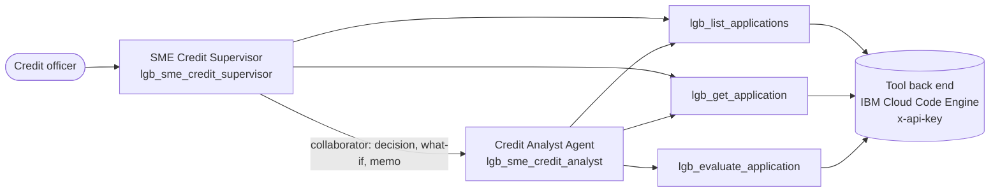

# watsonx Orchestrate: agents, tools and limits

How the Lionsgate SME Credit Desk agents are built on IBM watsonx Orchestrate, what they can call,
and what they are not allowed to do.

## What is deployed where

| Component | Where it runs | Definition |
|---|---|---|
| SME Credit Supervisor (`lgb_sme_credit_supervisor`) | IBM watsonx Orchestrate | [`orchestrate/agents/sme_credit_supervisor.yaml`](../orchestrate/agents/sme_credit_supervisor.yaml) |
| Credit Analyst Agent (`lgb_sme_credit_analyst`) | IBM watsonx Orchestrate | [`orchestrate/agents/sme_credit_analyst.yaml`](../orchestrate/agents/sme_credit_analyst.yaml) |
| Policy engine tool (OpenAPI, 3 operations) | Imported into Orchestrate; calls the back end below | [`orchestrate/policy-engine-openapi.yaml`](../orchestrate/policy-engine-openapi.yaml) |
| Tool back end (this Node server: policy engine and case lookups) | IBM Cloud Code Engine | [`server.js`](../server.js), [`Dockerfile`](../Dockerfile) |

The tool's `x-api-key` header comes from an Orchestrate API-key connection. No tenant URL, key or
credential is in this repository; the committed `servers` URL is a placeholder.

**Scope.** Two agents are built: the Supervisor and the Credit Analyst. The Document Intake, KYB &
Screening and Customer Comms agents are designed (they appear in the console) but not yet built
in Orchestrate. In the public demo at
[knijesh.github.io/lionsgate-sme-credit-desk-site](https://knijesh.github.io/lionsgate-sme-credit-desk-site/)
the agent steps are simulated; the policy engine, approvals, policy change control and audit chain
are the real code.

## Structure

The Supervisor answers queue questions and hands anything about a specific decision, a what-if or a
credit memo to the Credit Analyst.

## Tools

One OpenAPI tool with three operations. There is deliberately no operation that approves, declines
or returns an application.

| Operation | Method and path | What it returns | Supervisor | Analyst |
|---|---|---|---|---|
| `lgb_evaluate_application` | `POST /api/policy/evaluate` | Engine decision, risk grade, price, approval level, full rule trace with policy clauses, guardrails | – | ✓ |
| `lgb_get_application` | `GET /api/applications/{id}` | One application with agent trail, evaluation and approvals | ✓ | ✓ |
| `lgb_list_applications` | `GET /api/applications` | Today's applications with stage, engine decision and approval level | ✓ | ✓ |

## What an agent cannot do

| Action | Can an agent do it? | Why not |
|---|---|---|
| Approve an application | No | No tool operation exists for it; approvals are signed by people in the console under their own authority |
| Decline an application | No | No tool operation exists for it; declines come from the engine (knockouts) or a human decline review |
| Return an application | No | No tool operation exists for it; the Analyst's instructions tell it to send the user to the console |
| State an outcome before the engine responds | No | The Analyst's instructions forbid stating or hinting at an outcome until `lgb_evaluate_application` returns; the Supervisor may only report an outcome that `lgb_list_applications` or `lgb_get_application` shows |
| Use protected attributes | No | The engine strips gender, ethnicity, religion, marital status, age and nationality (CP-1.3); the Analyst is instructed never to use or mention them |

The first three are enforced by the tool surface itself; the last two rely on the engine and on
agent instructions.

## Screenshots

<!-- Placeholders: add these files to site/assets/ before publishing. -->

**Agents in Orchestrate**

**The Credit Analyst's tools**

**The OpenAPI tool with its three operations**

**The Credit Analyst declining to approve**

## Importing into your own instance

See [README § Built and hosted on watsonx Orchestrate](../README.md#built-and-hosted-on-watsonx-orchestrate)
and [GUIDE § 12](../GUIDE.md#12-watsonx-orchestrate-integration) for the connection and import commands.
